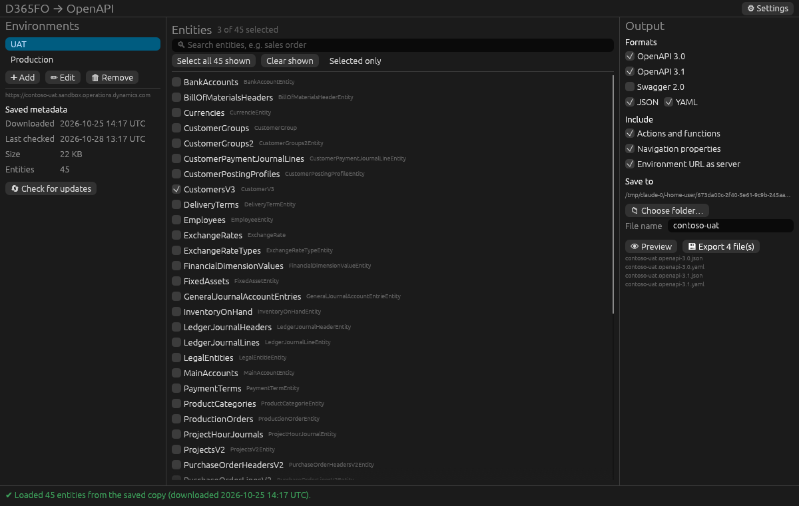
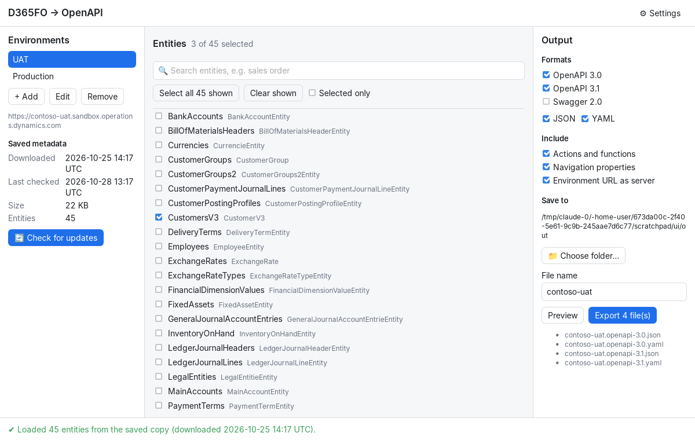
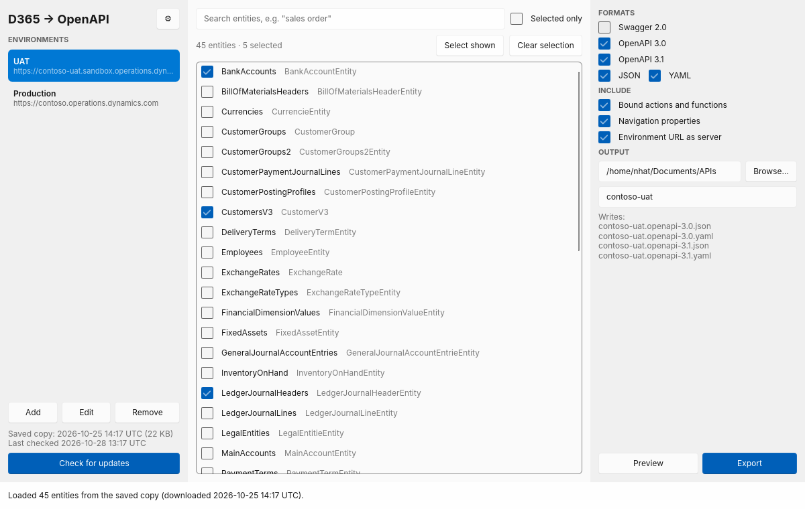
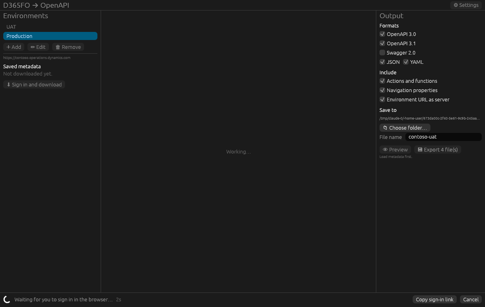

# D365FO OData metadata to OpenAPI

Desktop tool written in Rust that converts the OData `$metadata` of a
Dynamics 365 environment into **OpenAPI 3.0**, **OpenAPI 3.1** or
**Swagger 2.0** specifications (JSON or YAML), for only the entities you
choose.

It works with:

| Platform | Example URL | Service root |
|---|---|---|
| Finance & Operations (D365FO) | `https://contoso.operations.dynamics.com` | `/data` |
| Dataverse: Customer Engagement (Sales, Customer Service), Field Service, Power Apps | `https://contoso.crm4.dynamics.com` | `/api/data/v9.2` |

The app picks the platform from the URL: a host with a `crm`, `crm4`,
`crm11`… part is Dataverse. Field Service tables (`msdyn_workorders` etc.) are
part of the Dataverse metadata, so you find them with the search box.

It comes with three front ends that share all logic, settings and saved
metadata. Use whichever you prefer:

| | egui app | Tauri app | Slint app |
|---|---|---|---|
| Crate | `crates/d365-openapi-app` | `crates/d365-openapi-tauri` | `crates/d365-openapi-slint` |
| UI | Native immediate-mode UI (OpenGL) | Web UI in the system WebView (WebView2 on Windows) | Native declarative UI (`.slint` markup, OpenGL) |
| Look | Dark theme | Follows the system light/dark theme | Fluent style, follows the system light/dark theme |







## Status

- [x] Converter core (`crates/d365-openapi-core`)
- [x] Browser sign-in, metadata download, local cache, settings (`crates/d365-fetch`)
- [x] egui desktop app
- [x] Tauri desktop app
- [x] Slint desktop app
- [ ] Verified imports (Swagger UI, Azure API Management, codegen) and installers

## Signing in

The app signs in with your own work account in the browser (interactive
sign-in). No secrets are stored; tokens only live in memory while the app runs.

### Without an app registration

Leave **Tenant ID** and **Client ID** empty when you add an environment. The
app then signs in with the Azure CLI's public client ID
(`04b07795-8ddb-461a-bbee-02f9e1bf7b46`, which exists in every tenant), and your
work account picks its own tenant.

This works if your tenant allows that Microsoft app to get tokens for
Dynamics 365 (it usually does). If an admin has blocked it or requires
consent, sign-in fails with an `AADSTS` error. Then use your own app
registration (below).

### With your own app registration

1. Azure portal → **App registrations** → **New registration**. Any name,
   single tenant.
2. **Authentication** → **Add a platform** → **Mobile and desktop
   applications** → custom redirect URI `http://localhost`.
   Set **Allow public client flows** to **Yes**.
3. **API permissions** → **Add a permission**, then:
   - Finance & Operations: **APIs my organization uses** →
     **Microsoft Dynamics ERP** → Delegated → `Odata.FullAccess`.
   - Dataverse: **Dynamics CRM** → Delegated → `user_impersonation`.

   Grant admin consent if your tenant requires it.
4. Copy the **Application (client) ID** and **Directory (tenant) ID** into the
   environment's **Client ID** and **Tenant ID**.

Either way, your user needs normal access to the data. No extra setup is
needed in D365FO or Dataverse.

## Using the app

1. **Add** an environment: a name, its URL (e.g.
   `https://contoso-uat.sandbox.operations.dynamics.com` or
   `https://contoso.crm4.dynamics.com`), and optionally a
   tenant ID and client ID (see *Signing in*).
2. **Sign in and download.** The browser opens for sign-in. The status bar
   shows a spinner, the elapsed time and a progress bar while the metadata
   downloads. **Copy sign-in link** helps if the browser does not open;
   **Cancel** stops the task.
3. The metadata is **saved**. Next time the app starts, it loads the saved copy
   from disk with no sign-in. **Check for updates** downloads again and replaces
   the saved copy only if D365FO changed.
4. **Search** (all words must match the entity set or type name) and tick the
   entities you want. Your selection is remembered per environment.
5. Pick **formats** (OpenAPI 3.0 / 3.1 / Swagger 2.0 and JSON / YAML) and what
   to include (actions and functions, navigation properties, the environment
   URL as server), then an output folder and a file name.
6. **Preview** or **Export**. You get one file per chosen version and format,
   e.g. `contoso-uat.openapi-3.0.json`.

**Settings** changes the folder where metadata is saved; existing files are
moved to the new folder.



### Where things are stored

| What | Windows |
|---|---|
| Settings (environments, metadata folder) | `%APPDATA%\D365 OpenAPI\config\settings.json` |
| Selections and output choices | `%APPDATA%\D365 OpenAPI\config\app_state.json` |
| Saved metadata (default) | `%APPDATA%\D365 OpenAPI\data\metadata\<host>.xml` and `<host>.json` |

On Linux and macOS the same files are under the usual config and data folders.

## Building and running

Install Rust from <https://rustup.rs>, then:

```sh
# egui app
cargo run --release -p d365-openapi-app

# Tauri app
cargo run --release -p d365-openapi-tauri

# Slint app
cargo run --release -p d365-openapi-slint

# all tests
cargo test
```

**Tauri installers** (MSI and NSIS) on Windows: install the Tauri CLI with
`cargo install tauri-cli --version "^2"`, then run `cargo tauri build` in
`crates/d365-openapi-tauri`.

**Linux** needs the WebKitGTK packages to build the Tauri app
(`libwebkit2gtk-4.1-dev`, `libgtk-3-dev`).

### Releases

Publishing a GitHub release runs `.github/workflows/release.yml`, which builds
all three apps on Windows and macOS and attaches to the release:

- `d365fo-openapi-{egui,tauri,slint}-<version>-windows-x64.zip`
- the Tauri MSI and NSIS installers
- `d365fo-openapi-{egui,tauri,slint}-<version>-macos-universal.dmg`

The macOS apps run on Apple Silicon and Intel Macs.

To attach binaries to a release that already exists, run the workflow manually
(**Actions** → **Release binaries** → **Run workflow**) and enter its tag.

### Troubleshooting

- **The egui window flickers or does not open.** It draws with OpenGL by
  default. Start it with `D365_OPENAPI_RENDERER=wgpu` to try DirectX 12 /
  Vulkan / Metal instead.
- **The Tauri app does not start on Windows.** It needs the WebView2 runtime,
  which is preinstalled on Windows 10 and 11. A build made with the GNU
  toolchain also needs `WebView2Loader.dll` next to the exe.
- **macOS says the app "is damaged" or "cannot be opened".** The apps are not
  notarized by Apple. Drag the app to Applications, then run
  `xattr -dr com.apple.quarantine "/Applications/<app name>.app"`, or
  right-click the app and select **Open**.
- **Sign-in fails with `AADSTS…`.** Your tenant blocks sign-in without an app
  registration. Create one (see *Signing in*) and enter its IDs.

## Project layout

| Crate | What it does |
|---|---|
| `d365-openapi-core` | Parses `$metadata` and generates OpenAPI / Swagger |
| `d365-fetch` | Browser sign-in, metadata download with progress, cache, settings |
| `d365-openapi-desktop` | Shared app logic: saved UI state, search, load / download / export pipelines |
| `d365-openapi-app` | egui front end |
| `d365-openapi-tauri` | Tauri front end (`ui/` holds plain HTML, CSS and JS, with no npm build) |
| `d365-openapi-slint` | Slint front end (`ui/app.slint` holds the layout) |

### What the generated spec contains

For each selected entity set:

- `GET/POST /data/{EntitySet}` with `$filter`, `$select`, `$expand`, `$orderby`,
  `$top`, `$skip`, `$count` and (D365FO only) `cross-company`
- `GET/PATCH/DELETE /data/{EntitySet}(key1='{key1}',key2='{key2}')`
- For Dataverse the paths start with `/api/data/v9.2` instead, e.g.
  `/api/data/v9.2/accounts({accountid})`
- Bound actions and functions
- Schemas for the entity types plus every enum and complex type they use.
  Navigation properties are kept only when their target is also selected.
- Bearer token security, and `ODataError` as the error response

### Command-line examples

Convert a saved metadata file:

```sh
cargo run -p d365-openapi-core --example convert -- metadata.xml openapi-3.0 yaml CustomersV3 SalesOrderHeadersV2
```

Versions: `swagger-2.0`, `openapi-3.0`, `openapi-3.1`. Formats: `json`, `yaml`.
Leave out the entity sets to include all of them.

Sign in, download and save metadata (tenant and client ID are optional):

```sh
cargo run -p d365-fetch --example fetch -- https://contoso.operations.dynamics.com [tenant-id] [client-id]
```
